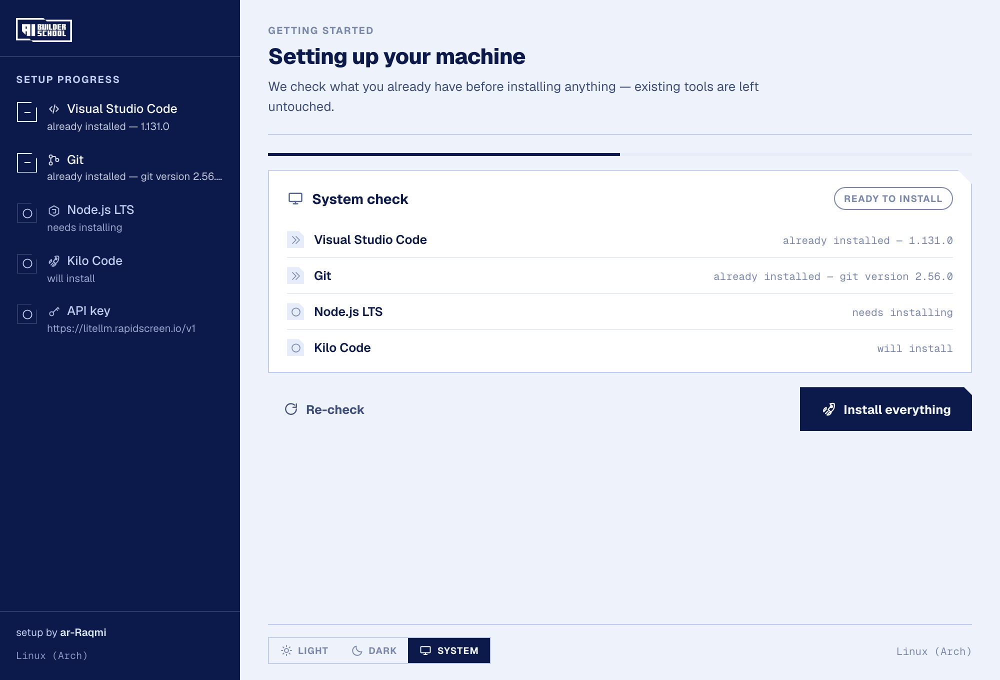
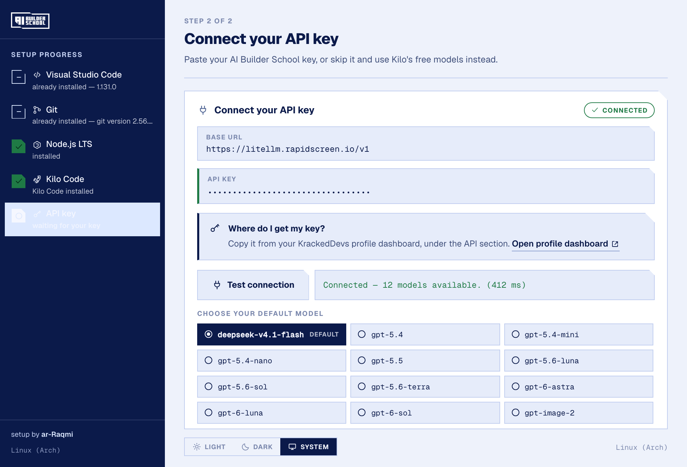
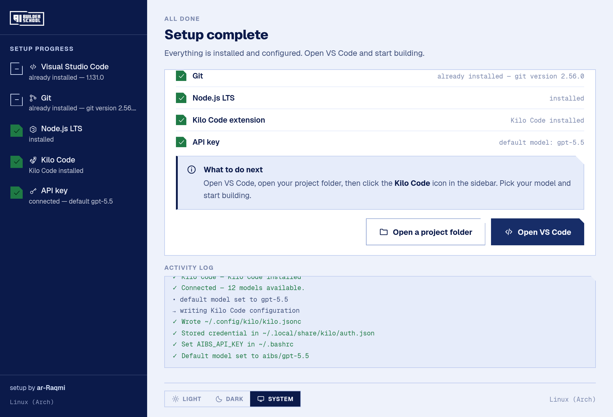
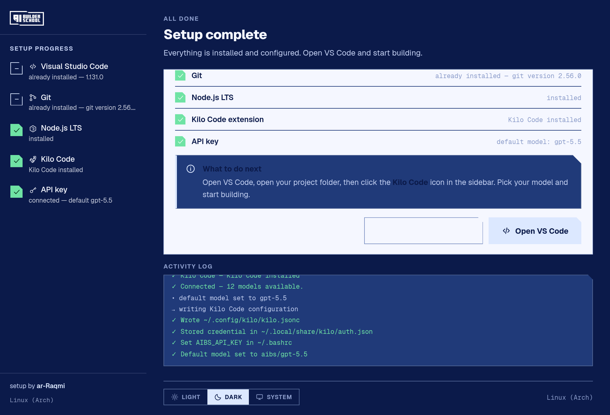

<div align="center">
  
  <h1>AI Builder School Installer</h1>
  <p><em>Press install, paste your API key, start vibe coding.</em></p>
</div>

I've been enjoying entering the **AI Builder School**, but the problem I kept seeing is that we always waste so much time on the setup session instead of the actual coding. Every class someone's stuck on installing VSCode, or Git isn't on the PATH, or Kilo Code isn't connected or the API key isn't working and by the time everyone's sorted, half the session is gone. :<

So I made this **AI Builder School Installer** :>

## Download

Grab the file for your machine from the [**Releases page**](../../releases/latest):

| Your computer | Download |
|---|---|
| **Windows** | `.exe` (easiest) or `.msi` |
| **macOS** | `.dmg` |
| **Linux** | `.AppImage` — works on Arch, Ubuntu, Fedora, anything |

> **Linux:** use the **AppImage**, not the `.deb`. The AppImage is self-contained so it
> runs on any distro; the `.deb` is only for Debian/Ubuntu and the `.rpm` only for
> Fedora. Make it executable and run it:
> ```bash
> chmod +x "AI Builder School Setup_0.1.0_amd64.AppImage"
> ./"AI Builder School Setup_0.1.0_amd64.AppImage"
> ```

The builds aren't code-signed yet, so your OS may grumble the first time — [what to do
about it](docs/RELEASING.md#code-signing-not-done-yet).



It handles the whole boring part in one go. You double-click it, and it sets up **VS Code → Git → Node.js → Kilo Code → your API key**. Then you just open VS Code, open your folder, click Kilo Code and you're building.

---

## What it actually does

**It checks first, then installs.** If you already have VSCode, it skips it and leaves it alone. Same for Git and Node. Nothing gets reinstalled or overwritten, so if your machine is already set up for other stuff, it stays that way.

**Then it installs whatever's missing.** Windows uses `winget`, macOS uses `brew`, Linux figures out whether you're on Arch, Debian or Fedora and uses the right one. You don't have to know any of this — it just does it.

**Then Kilo Code gets installed into VSCode** so the extension is already there when you open the editor.

**Then you paste your API key.** Hit *Test connection* and it pings the gateway for real — if the key is wrong you find out immediately, not halfway through a lesson. Once it connects, it pulls the live list of models so you can pick which one you want.



**Don't have a key yet?** There's a *Skip* button. It finishes the setup anyway and you can use Kilo Code's own free models in the meantime. Nothing breaks.

**Then it's done,** and it tells you exactly what to do next.



---

## Your API key

From your **KrackedDevs profile dashboard** — the installer links straight to it so you don't have to go hunting:
<https://krackeddevs.com/dashboard/profile>

The gateway is `https://litellm.rapidscreen.io/v1`, OpenAI-compatible, so it works as a custom provider in Kilo Code.

## Which model?

The default is **`deepseek-v4.1-flash`** — it's fast and cheap and more than enough for the course. You can pick something else during setup and it remembers your choice next time. The list comes from the gateway live, so whatever's actually available right now is what you'll see.

There's also `gpt-5.6-sol`, `gpt-6-astra`, `no-claude-models-bruh` and plenty more if you want to poke around.

---

## Dark mode

Because of course.



---

## If you're running it yourself

Only three things to know: **Rust**, **Node 18+**, and on Linux also `webkit2gtk-4.1` and `base-devel`.

```bash
npm install
npm run dev
```

To build the installers:

```bash
npm run build:linux    # .deb, .AppImage, .rpm
npm run build:mac      # .dmg, .app
npm run build:win      # .msi, .exe
```

macOS and Windows bundles have to be built **on** macOS and Windows — that's a Tauri/WebKit thing, not something I can work around. There's a GitHub Actions workflow that builds all three on native runners.

There's a test suite if you're poking at the code — `npm run test:ui` drives the whole flow in a real browser, and `cargo test` runs the Rust units. The live tests hit the real gateway, so they're opt-in:

```bash
cd src-tauri
AIBS_TEST_KEY=sk-... cargo test --test live -- --ignored
```

---

## Status

**Tested on Linux** (Arch / EndeavourOS) — the installers build and the whole flow runs. macOS and Windows code paths are written and configured, but I haven't run them on real hardware yet, so those are still unverified.

---

<div align="center">

  *🖋️ the pen hasn't lifted*

  setup by <a href="https://ar-raqmi.net/">ar-Raqmi</a>

</div>